<!-- Profile README for github.com/Fluory. Graphics in assets/ are generated by tools/build.py
     from tools/projects.json – edit the list there, then run: python3 tools/build.py -->

<a href="https://fluory.github.io/Fluory/">
  <picture>
    <source media="(prefers-color-scheme: dark)" srcset="assets/hero-dark.svg">
    
  </picture>
</a>

Ich bin Florian und komme aus der Nähe von Heilbronn. Ich studiere dual Wirtschaftsinformatik (Data Science)
an der DHBW und arbeite im Prototyping eines Handelsunternehmens. Daneben baue ich als Selbstständiger Software
für kleine und mittlere Betriebe: Programme, die Dokumente auslesen, wiederkehrende Arbeit übernehmen oder
Zahlen aus Excel-Listen lesbar machen.

Ein Auftrag dauert meist zwei bis sechs Wochen und hat einen Festpreis. Was ich anbiete und was es kostet,
steht auf [meiner Website](https://final-portfolio-website-ten.vercel.app/de/). Eine kurze Übersicht mit
Bewegung gibt es auf [fluory.github.io/Fluory](https://fluory.github.io/Fluory/).

#### Projekte

<!-- projects:start -->

<a href="https://github.com/Fluory/RequestFlow"><picture><source media="(prefers-color-scheme: dark)" srcset="assets/card-requestflow-dark.svg"></picture></a>

<a href="https://github.com/Fluory/claude-sync-kit"><picture><source media="(prefers-color-scheme: dark)" srcset="assets/card-claude-sync-kit-dark.svg"></picture></a> <a href="https://github.com/Fluory/one-tile-a-day"><picture><source media="(prefers-color-scheme: dark)" srcset="assets/card-one-tile-a-day-dark.svg"></picture></a>

<a href="https://github.com/Fluory/wished-into-being"><picture><source media="(prefers-color-scheme: dark)" srcset="assets/card-wished-into-being-dark.svg"></picture></a> <a href="https://github.com/Fluory/Grow"><picture><source media="(prefers-color-scheme: dark)" srcset="assets/card-grow-dark.svg"></picture></a>

<a href="#projekte"><picture><source media="(prefers-color-scheme: dark)" srcset="assets/card-betriebscockpit-dark.svg"></picture></a> <a href="#projekte"><picture><source media="(prefers-color-scheme: dark)" srcset="assets/card-tourenplaner-dark.svg"></picture></a>

<a href="#projekte"><picture><source media="(prefers-color-scheme: dark)" srcset="assets/card-rechnungseingang-dark.svg"></picture></a> <a href="#projekte"><picture><source media="(prefers-color-scheme: dark)" srcset="assets/card-stromlast-dark.svg"></picture></a>

- RequestFlow: [Fallstudie](https://requestflow-doc-edit.vercel.app/case-study) · [Demo ohne Anmeldung](https://requestflow-doc-edit.vercel.app)
- One Tile a Day: [Live](https://one-tile-a-day.vercel.app)
- Wished into Being: [Live](https://wished-into-being.vercel.app) · [Wunsch abgeben](https://github.com/Fluory/wished-into-being/issues/new?template=wish.yml)

Betriebscockpit, Tourenplaner, Rechnungseingang und Stromlast-Prognose haben eigene Repos, die noch privat sind.
<!-- projects:end -->

#### Werkzeuge

Meistens TypeScript mit Next.js und PostgreSQL, für Daten und Modelle Python, für Apps Expo.

#### Kontakt

Am einfachsten über das [Formular auf der Website](https://final-portfolio-website-ten.vercel.app/de/#contact).
